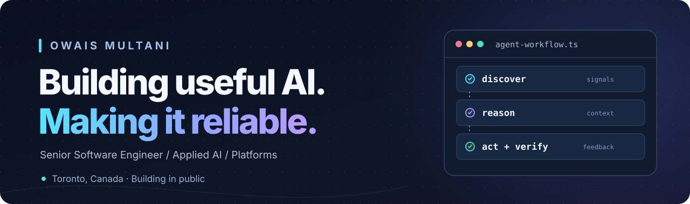

  

   

  <a href="https://nextroleai.owaism.xyz"><strong>Explore NextRole AI ↗</strong></a>
  &nbsp; · &nbsp;
  <a href="https://github.com/owaismultani/nextrole-ai"><strong>Open-source project ↗</strong></a>
  &nbsp; · &nbsp;
  <a href="https://dev.to/owaismultani"><strong>Writing ↗</strong></a>
  &nbsp; · &nbsp;
  <a href="https://www.linkedin.com/in/owaismultani"><strong>LinkedIn ↗</strong></a>

 

### Hey, I'm Owais.

I'm a senior software engineer based in Toronto, building at the intersection of **applied AI, backend engineering, and developer platforms**.

I like taking ambitious ideas past the prototype stage: designing dependable systems, connecting models to useful tools, and making AI workflows observable, secure, and genuinely helpful.

Right now I'm especially interested in **AI agents, MCP, automation, orchestration, and the feedback loops that make software more useful over time**.

---

## ✦ Building now

<table>
  <tr>
    <td width="53%" valign="top">
      <h3>NextRole AI · open source</h3>
      
A career workspace that connects job discovery, tailored applications, interview preparation, and application tracking.

      
My focus is making the automation reliable and keeping people in control of the decisions. The longer-term goal: turn the signals from a job search into meaningful ways to improve.

      
<strong><a href="https://nextroleai.owaism.xyz">Try the app ↗</a></strong> &nbsp;·&nbsp; <a href="https://github.com/owaismultani/nextrole-ai">Explore the code ↗</a>

      
React · TypeScript · Hono · PostgreSQL · Redis · MCP

    </td>
    <td width="47%" valign="middle">
      
    </td>
  </tr>
</table>

NextRole AI builds on <a href="https://github.com/AmruthPillai/Reactive-Resume">Reactive Resume</a> by Amruth Pillai and contributors.

## ✦ Selected projects

<table>
  <tr>
    <td width="50%" valign="top">
      <h3><a href="https://github.com/owaismultani/voice-map">VoiceMap ↗</a></h3>
      
Exploring how spoken ideas can become mind maps, flowcharts, and other visual diagrams.

      
<a href="https://voice-map-khaki.vercel.app">Project site</a> · <a href="https://github.com/owaismultani/voice-map">Source</a>

      
Voice interfaces · Visual tools · TypeScript

    </td>
    <td width="50%" valign="top">
      <h3><a href="https://github.com/owaismultani/Text2Code">Text2Code ↗</a></h3>
      
An earlier experiment in turning natural-language instructions into code with LLMs.

      
<a href="https://github.com/owaismultani/Text2Code">Explore the repository</a>

      
Python · Django · LLMs

    </td>
  </tr>
</table>

## ✦ What I work on

<table>
  <tr>
    <td width="33%" valign="top">
      <h3>01 / Applied AI</h3>
      
Agents, tool use, MCP, retrieval, context engineering, and human-in-the-loop workflows.

    </td>
    <td width="33%" valign="top">
      <h3>02 / Backend & data</h3>
      
Python services, distributed jobs, APIs, data pipelines, databases, and systems that hold up in production.

    </td>
    <td width="34%" valign="top">
      <h3>03 / Platforms</h3>
      
Containers, Kubernetes, CI/CD, cloud infrastructure, observability, and developer experience.

    </td>
  </tr>
</table>

**Tools I reach for**

<code>Python</code> · <code>TypeScript</code> · <code>React</code> · <code>FastAPI</code> · <code>Django</code> · <code>PostgreSQL</code> · <code>Redis</code> · <code>Docker</code> · <code>Kubernetes</code> · <code>OpenShift</code> · <code>Azure</code> · <code>Vercel</code>

## ✦ Notes from building

**[I Built an AI Job Hunter That Runs While I Sleep](https://dev.to/owaismultani/i-built-an-ai-job-hunter-that-runs-while-i-sleep-3an7)**

Why I built NextRole AI, what I learned making unattended workflows reliable, and where I want to take the platform next.

[More writing on DEV.to ↗](https://dev.to/owaismultani)

---

  ### Let's build useful things.

  I'm always up for conversations about applied AI, engineering problems, and open source.

  **[LinkedIn](https://www.linkedin.com/in/owaismultani)** &nbsp; · &nbsp; **[DEV.to](https://dev.to/owaismultani)** &nbsp; · &nbsp; **[GitHub](https://github.com/owaismultani)**

  Less demo theatre. More useful software.

